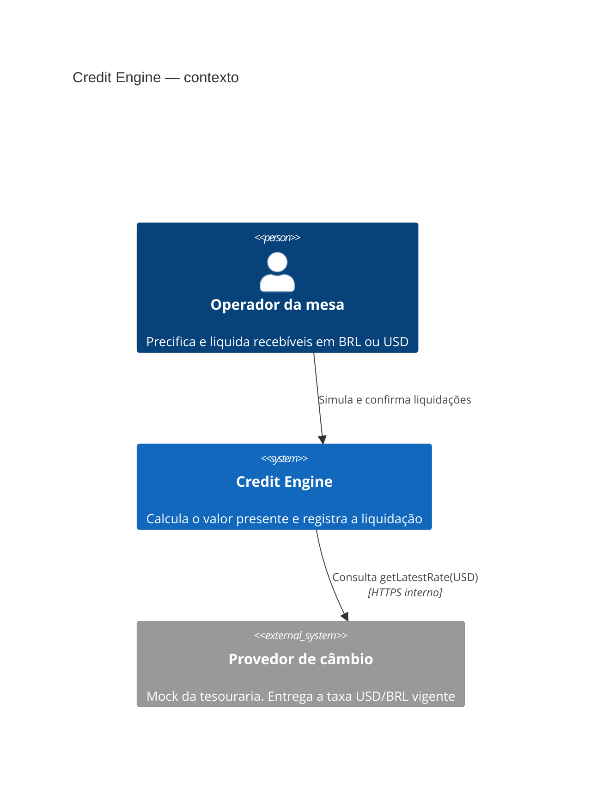
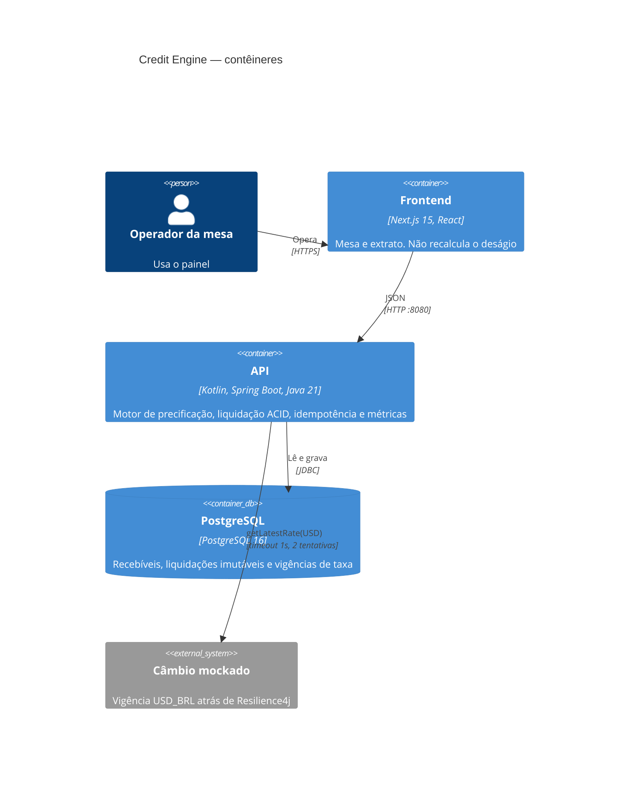

# C4 — Credit Engine

Diagramas de contexto e de contêineres. O câmbio é um provedor mockado: a API lê a vigência `USD_BRL` atrás de timeout, retry e circuit breaker.

## Nível 1 — System Context

## Nível 2 — Container

